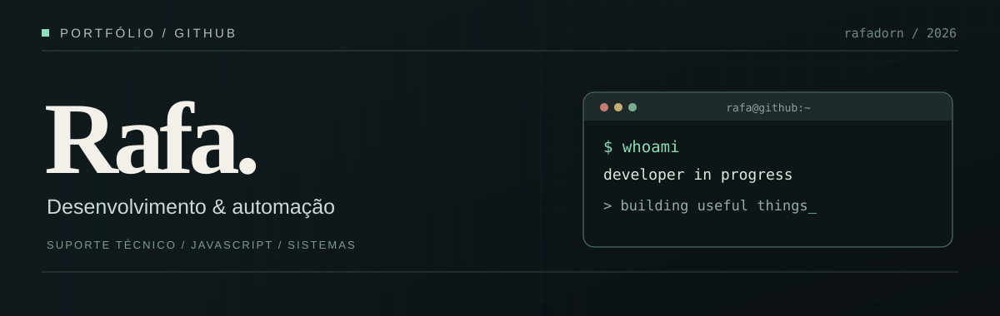

<p align="right"><sub>DESENVOLVIMENTO &nbsp; / &nbsp; AUTOMAÇÕES &nbsp; / &nbsp; PORTFÓLIO</sub></p>



<br>

## Olá, sou Rafa.

Desenvolvo soluções que unem **programação, automação e experiências digitais**. Trabalho com suporte técnico, integrações e validações de processos, enquanto aprofundo meus estudos em **Análise e Desenvolvimento de Sistemas**.

```text
rafa@dev:~$ cat agora.txt
> desenvolvimento web · automações · interfaces · aprendizado contínuo
```

<sub>STACK & FERRAMENTAS</sub>

`JavaScript` &nbsp; `Node.js` &nbsp; `HTML / CSS` &nbsp; `PowerShell` &nbsp; `Git` &nbsp; `Supabase` &nbsp; `GitHub Actions`

<br>

---

### 01 / PROJETO SELECIONADO

# Camylle Teske — portfólio digital

Um portfólio com linguagem **editorial e visual**, desenvolvido para valorizar trabalhos de identidade, campanhas, conteúdo digital e design de embalagem. O site reúne uma navegação focada nos projetos com um painel para gestão de conteúdo e um processo de publicação automatizado.

**Meu trabalho:** desenvolvimento web, integração com Supabase, painel de conteúdo e automação de publicação.  
**Direção visual e projetos:** Camylle Teske.

[**Ver portfólio ↗**](https://camylle-teske.com.br/) &nbsp; · &nbsp; [**Explorar o código ↗**](https://github.com/rafadorn/camylle-teske)

<br>

<p align="right"><sub>PROJETOS REAIS PUBLICADOS NO PORTFÓLIO &nbsp; / &nbsp; 01—04</sub></p>

<table>
  <tr>
    <td width="50%" valign="top">
      <a href="https://camylle-teske.com.br/projetos/clube-delas/"></a><br>
      <sub>01 / PROJETO</sub><br><strong><a href="https://camylle-teske.com.br/projetos/clube-delas/">Clube Delas ↗</a></strong>
    </td>
    <td width="50%" valign="top">
      <a href="https://camylle-teske.com.br/projetos/odara-tattoo/"></a><br>
      <sub>02 / PROJETO</sub><br><strong><a href="https://camylle-teske.com.br/projetos/odara-tattoo/">Odara Tattoo ↗</a></strong>
    </td>
  </tr>
  <tr>
    <td width="50%" valign="top">
      <a href="https://camylle-teske.com.br/projetos/leao-ice-bubble-tea/"></a><br>
      <sub>03 / PROJETO</sub><br><strong><a href="https://camylle-teske.com.br/projetos/leao-ice-bubble-tea/">Leão Ice Bubble Tea ↗</a></strong>
    </td>
    <td width="50%" valign="top">
      <a href="https://camylle-teske.com.br/projetos/feito-por-d/"></a><br>
      <sub>04 / PROJETO</sub><br><strong><a href="https://camylle-teske.com.br/projetos/feito-por-d/">Feito por Dai ↗</a></strong>
    </td>
  </tr>
</table>

<p align="center"><sub>Uma seleção do trabalho visual de Camylle Teske. Imagens e projetos pertencem à autora.</sub></p>

<br>

---

### 02 / PROJETO SELECIONADO

# Create of Art — marca, site & experiência digital

Uma experiência web para a **Create of Art**, com estética de campanha, navegação editorial e interface de pré-venda. O site apresenta a coleção **Verão 27**, permite explorar peças e organiza o fluxo de interesse e reserva, **sem pagamento nesta etapa**.

**Meu trabalho:** desenvolvimento da experiência web, interações visuais, estrutura do catálogo, painel administrativo e integrações técnicas.  
**Tecnologias do projeto:** JavaScript / TypeScript, Node.js, Cloudflare Workers, D1 e integração de e-mails com Resend.  
**Repositório:** mantido na conta [CreateOFart](https://github.com/CreateOFart), com código privado.

[**Explorar o site ↗**](https://createofart.com.br/)

<br>

<a href="https://createofart.com.br/">
  
</a>

<table>
  <tr>
    <td width="50%" valign="top">
      <a href="https://createofart.com.br/"></a>
    </td>
    <td width="50%" valign="top">
      <a href="https://createofart.com.br/"></a>
    </td>
  </tr>
</table>

<p align="center"><sub>Visuais originais do site Create of Art · Projeto publicado em outra conta do GitHub.</sub></p>

<br>

---

### 03 / SOBRE O QUE ESTOU CONSTRUINDO

**Automação de processos** — scripts, verificações e integração de sistemas para reduzir tarefas repetitivas e melhorar a confiabilidade dos fluxos.

**Desenvolvimento web** — interfaces e aplicações, com foco em arquitetura prática, manutenção e experiência de uso.

**Aprendizado contínuo** — aprofundamento em JavaScript, Node.js, testes e boas práticas de engenharia de software.

<br>

---

<sub><code>status: construindo, estudando e evoluindo.</code> &nbsp; · &nbsp; [github.com/rafadorn](https://github.com/rafadorn)</sub>
