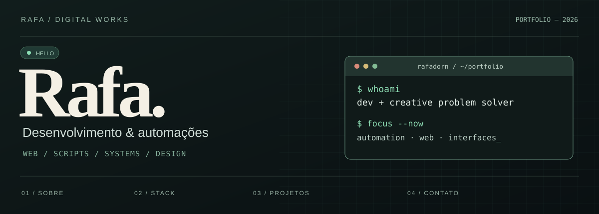

<code>rafadorn.github.io / profile</code> · DIGITAL PORTFOLIO / 2026

  

  <a href="#sobre-mim">Sobre mim</a> &nbsp;·&nbsp;
  <a href="#tecnologias">Tecnologias</a> &nbsp;·&nbsp;
  <a href="#projetos">Projetos</a> &nbsp;·&nbsp;
  <a href="#contato">Contato</a>

 

### 01 / OI, SOU O RAFA.

Gosto de resolver problemas com **código, automação e design**. Trabalho com suporte técnico e desenvolvimento de fluxos, criando validações, scripts e integrações que simplificam processos reais. Também desenvolvo experiências para a web — do front-end às ferramentas de publicação.

Estou cursando **Análise e Desenvolvimento de Sistemas**, aprofundando minhas habilidades em JavaScript, Node.js e engenharia de software.

<table>
  <tr>
    <td width="55%" valign="top">
      EM CONSTRUÇÃO  
      <strong>Interfaces, automações e software útil.</strong> 
      Do problema técnico à experiência que chega ao usuário.
    </td>
    <td width="45%" valign="top">
      AGORA / FOCO ATUAL  
      <code>JavaScript &amp; Node.js</code> 
      <code>Desenvolvimento web</code> 
      <code>Automação de processos</code>
    </td>
  </tr>
</table>

<strong>Um pouco mais sobre minha trajetória</strong>

 
Minha atuação combina suporte técnico, análise de arquivos e automação de fluxos de produção. Nesse caminho, venho transformando tarefas repetitivas e verificações manuais em scripts e integrações. Em paralelo, construo produtos e sites com uma preocupação especial por clareza visual, manutenção e experiência de uso.

 

### 02 / TECNOLOGIAS & FERRAMENTAS

  
  
  
  
  
  
  
  
  
  

LINGUAGENS / FRONT-END / BACK-END / AUTOMAÇÃO / INFRAESTRUTURA

`JavaScript` · `TypeScript` · `Node.js` · `HTML` · `CSS` · `PowerShell` · `Git` · `Supabase` · `GitHub Actions` · `Cloudflare`

 

---

### 03 / SELECTED WORK

Projetos em que participei do **desenvolvimento e das integrações técnicas**, preservando a identidade visual e os créditos de quem criou cada trabalho.

 

### CASE 01 / IDENTIDADE & PORTFÓLIO DIGITAL

# Camylle Teske — portfólio digital

Um portfólio com linguagem **editorial e visual**, desenvolvido para valorizar trabalhos de identidade, campanhas, conteúdo digital e design de embalagem. O site reúne uma navegação focada nos projetos com um painel para gestão de conteúdo e um processo de publicação automatizado.

**Meu trabalho:** desenvolvimento web, integração com Supabase, painel de conteúdo e automação de publicação.  
**Direção visual e projetos:** Camylle Teske.

[**Ver portfólio ↗**](https://camylle-teske.com.br/) &nbsp; · &nbsp; [**Explorar o código ↗**](https://github.com/rafadorn/camylle-teske)

 

PROJETOS REAIS PUBLICADOS NO PORTFÓLIO &nbsp; / &nbsp; 01—04

<table>
  <tr>
    <td width="50%" valign="top">
       
      01 / PROJETO <strong><a href="https://camylle-teske.com.br/projetos/clube-delas/">Clube Delas ↗</a></strong>
    </td>
    <td width="50%" valign="top">
       
      02 / PROJETO <strong><a href="https://camylle-teske.com.br/projetos/odara-tattoo/">Odara Tattoo ↗</a></strong>
    </td>
  </tr>
  <tr>
    <td width="50%" valign="top">
       
      03 / PROJETO <strong><a href="https://camylle-teske.com.br/projetos/leao-ice-bubble-tea/">Leão Ice Bubble Tea ↗</a></strong>
    </td>
    <td width="50%" valign="top">
       
      04 / PROJETO <strong><a href="https://camylle-teske.com.br/projetos/feito-por-d/">Feito por Dai ↗</a></strong>
    </td>
  </tr>
</table>

Uma seleção do trabalho visual de Camylle Teske. Imagens e projetos pertencem à autora.

 

---

### CASE 02 / E-COMMERCE & EXPERIÊNCIA DIGITAL

# Create of Art — marca, site & experiência digital

Uma experiência web para a **Create of Art**, com estética de campanha, navegação editorial e interface de pré-venda. O site apresenta a coleção **Verão 27**, permite explorar peças e organiza o fluxo de interesse e reserva, **sem pagamento nesta etapa**.

**Meu trabalho:** desenvolvimento da experiência web, interações visuais, estrutura do catálogo, painel administrativo e integrações técnicas.  
**Tecnologias do projeto:** JavaScript / TypeScript, Node.js, Cloudflare Workers, D1 e integração de e-mails com Resend.  
**Repositório:** mantido na conta [CreateOFart](https://github.com/CreateOFart), com código privado.

[**Explorar o site ↗**](https://createofart.com.br/)

 

<table>
  <tr>
    <td width="50%" valign="top">
      
    </td>
    <td width="50%" valign="top">
      
    </td>
  </tr>
</table>

Visuais originais do site Create of Art · Projeto publicado em outra conta do GitHub.

 

---

 

---

### 04 / ONDE ME ENCONTRAR

  
  
  

<code>$ keep building_</code> · feito com atenção aos detalhes

